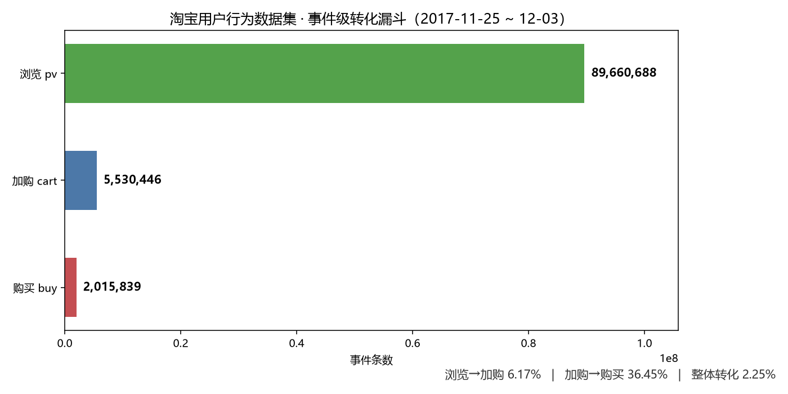
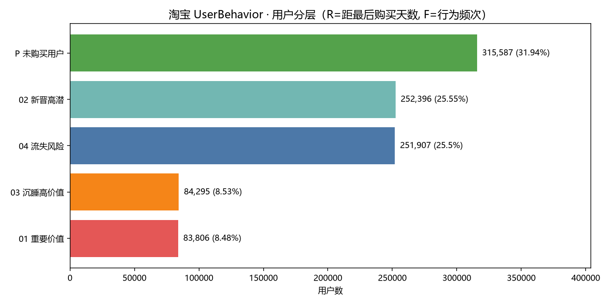
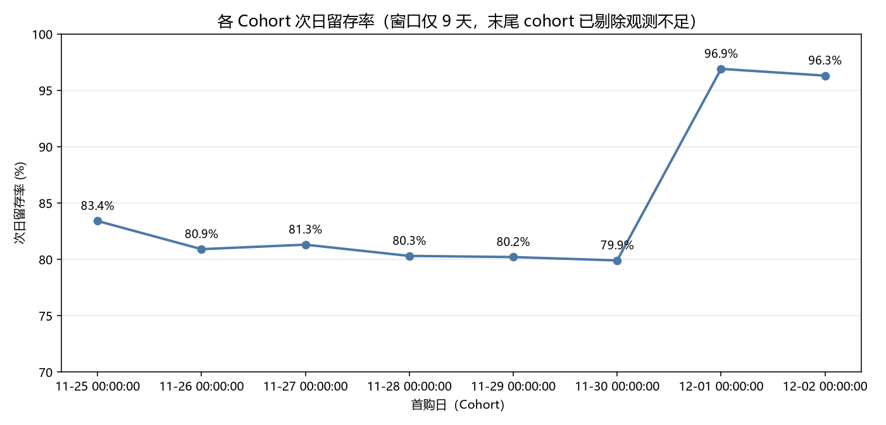

# 电商用户行为分析

> **一句话结论**：淘宝 1 亿条行为日志显示，浏览→加购转化率仅 **6.17%**，是全链路最大漏点；同时 **31.94% 的用户 9 天内人均 79 次行为却零购买**。两个证据共同指向「加购环节缺钩子」——建议把运营资源从催付转向提升加购率。



---

## 项目简介

对 1 亿条电商行为日志做端到端分析：还原转化漏斗、量化 Cohort 留存、做 RFM 用户分层，并把数字翻译成可执行的运营动作。

**技术栈**：DuckDB（亿级数据秒级查询）· Python 3.12 / pandas / matplotlib · MySQL 8.0（方言验证）· Tableau Public（看板）

**完整分析报告**：见 [`reports/01_findings.md`](reports/01_findings.md)

## 数据

| 项 | 内容 |
|---|---|
| 来源 | 阿里天池 [淘宝用户购物行为数据集](https://tianchi.aliyun.com/dataset/649)（UserBehavior）|
| 规模 | **100,150,807 行**，3.42 GB CSV → 632 MB Parquet |
| 时间 | 2017-11-25 ~ 2017-12-03（9 天）|
| 字段 | `user_id` / `item_id` / `category_id` / `behavior`（pv·fav·cart·buy）/ `ts` |
| 数据质量 | MD5 校验通过；99.945% 时间戳有效，5.5 万行（0.055%）损坏已过滤 |

> 数据文件不入库（见 `.gitignore`），按 `reports/01_findings.md` 第六节复现。

## 核心发现

**1. 漏点在加购，不在催付**

事件级漏斗：浏览 8,966 万 → 加购 553 万（**6.17%**）→ 购买 202 万（**36.45%**），整体转化 **2.25%**。
「加购→购买」有 36.45%，说明用户一旦加购，下单意愿很强——问题是**没人加购**。

**2. 32% 的人来了但没买**

315,587 人（31.94%）9 天内人均 **79 次**行为、零购买，是最大的转化机会池，对应动作是首单券 + 低门槛引流品。

**3. 高价值用户正在沉睡**

84,263 人（8.53%）人均行为 **237 次**（全场最活跃），但最近购买已在 **4.4 天**前。这批人流失的损失远大于普通用户，应优先触达。



**4. 留存稳定 81%，但不能当行业基准**

窗口完整 cohort 的次日留存 **81.3%**。但样本本身是活跃用户，存在选择偏差（真实电商次日留存通常 20–40%），结论只能表述为「本样本内」。



## 口径定义（避免和业务方吵架）

| 指标 | 定义 | 注意点 |
|---|---|---|
| 事件级转化率 | 下一环节事件数 / 上一环节事件数 | 反映点击效率，行业常用 |
| 人级转化率 | 去重用户数之比 | 9 天累计会放大到 68%，与事件级差 12 倍 |
| 次日留存 | 首购后第 1 天有任意行为的用户 / cohort 规模 | 按 `DATEDIFF`，不是自然日 |
| R（RFM） | 距最后一次**购买**的天数 | 初版用「任意行为」→ 全员为 0，已修正 |
| M（RFM） | 购买次数 | 无金额字段，作价值代理指标 |

## 已知局限

| 局限 | 影响 |
|---|---|
| 仅有 9 天窗口 | 30 日留存、月度复购无法计算 |
| 无 session_id | 无法做严格「同一访问内」的漏斗 |
| 样本为活跃用户 | 留存偏高，不可作为行业基准 |
| 无金额字段 | GMV / 客单价 / LTV 无法计算 |

## 目录结构

```
ecommerce-user-behavior/
├── sql/                      分析 SQL（含口径注释与踩坑说明）
│   ├── 01_funnel.sql             转化漏斗
│   ├── 02_cohort_retention.sql   Cohort 留存
│   ├── 03_rfm.sql                RFM 分层
│   └── 04_anomaly.sql            异常归因模板
├── reports/                  图表与分析报告
│   ├── 01_findings.md            完整分析报告（2 页）
│   ├── 01_funnel_event_level.png
│   ├── 02_cohort_d1_retention.png
│   └── 04_rfm_segments.png
├── notebooks/                Jupyter 探索
├── dashboard/                Tableau 看板
└── data/                     原始数据（gitignore）
```

## 环境

```powershell
py -m pip install -r requirements.txt
```

依赖：pandas 3.1 / numpy 2.5 / matplotlib 3.11 / duckdb 2.0 / sqlalchemy / pymysql / plotly

## 踩过的坑

1. **CSV 无表头**：DuckDB 直接读会把列名认成 `column0`，必须用 `columns={...}` 显式声明。
2. **MySQL 8.0.21 崩溃**：`WITH x AS (...) SELECT ... FROM t CROSS JOIN (SELECT COUNT(*) FROM x)` 这类写法会触发优化器缺陷，导致 mysqld 直接退出。改成标量子查询即可。
3. **窗口函数与聚合混写**：`GROUP BY` 与 `RANK() OVER (ORDER BY SUM(...))` 写在同层会导致结果错误，必须用 CTE 先聚合再开窗。
4. **RFM 的 R 失效**：在短窗口高频样本上，用「任意行为」定义 R 会让所有人接近 0，需改为「距最后购买天数」。
